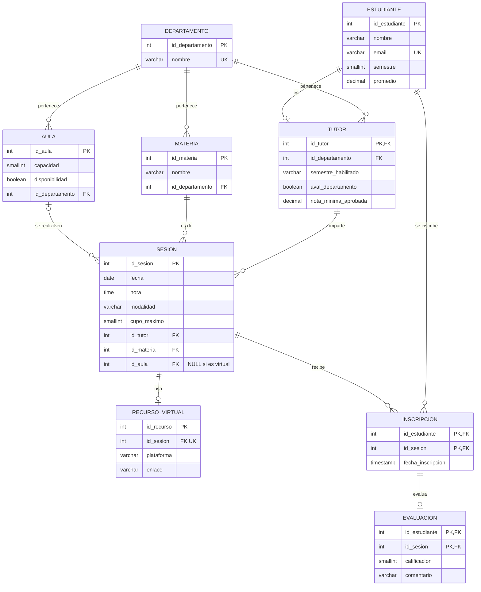

# Sistema de Tutorías — Modelo Relacional y Normalización

**Roldán Rodríguez y Santiago Merchan**

---

## 1. Alcance

Este informe transforma el diagrama Entidad–Relación del *Sistema de Tutorías* en un modelo relacional y documenta, paso a paso, la aplicación de las formas normales (1FN, 2FN, 3FN, FNBC, 4FN, 5FN) más un análisis de FNDK y 6FN. El resultado es el esquema implementado en `modelo_relacional_tutorias.sql`.

**Convenciones de notación:** <u>subrayado</u> = llave primaria (PK); *cursiva* = llave foránea (FK); `UQ` = restricción de unicidad (llave candidata alterna).

---

## 2. Del modelo E-R al modelo relacional

### 2.1 Reglas de transformación aplicadas

| Elemento del E-R | Cardinalidad | Decisión en el modelo relacional |
|---|---|---|
| Entidades fuertes (Departamento, Estudiante, Materia, Aula, Sesion, RecursoVirtual) | — | Una relación por entidad con sus atributos simples. |
| **Es** (Tutor – Estudiante) | 1:1 | Tutor se modela como especialización de Estudiante: `id_tutor` es PK y FK simultáneamente (tal como lo indica el diagrama, *PK,FK*). Los datos personales del tutor viven en ESTUDIANTE. |
| **Pertenece Tutor** | N:1 | FK `id_departamento` en TUTOR. |
| **Pertenece Materia** | N:1 | FK `id_departamento` en MATERIA. |
| **Pertenece Aula** | N:1 | FK `id_departamento` en AULA. |
| **Imparte** (Tutor – Sesion) | 1:N | FK `id_tutor` en SESION. |
| **Es de** (Materia – Sesion) | 1:N | FK `id_materia` en SESION. |
| **Se realiza en** (Aula – Sesion) | 1:1 | FK `id_aula` en SESION, con `UQ(id_aula, fecha, hora)` (ver §2.5). |
| **Usa** (Sesion – RecursoVirtual) | 1:1 | FK `id_sesion` con `UQ` en RECURSO_VIRTUAL. Se ubica del lado opcional para evitar nulos en SESION (las sesiones presenciales no tienen recurso). |
| **Inscribe** (Estudiante – Sesion) | N:M | Relación propia INSCRIPCION con PK compuesta y el atributo `fecha_inscripcion`. |
| **Evalua** (Estudiante – Sesion) | N:M | Relación propia EVALUACION con PK compuesta, atributos `calificacion` y `comentario`, y FK compuesta hacia INSCRIPCION. |

### 2.2 Esquema relacional final

- **DEPARTAMENTO** (<u>id_departamento</u>, nombre) — `UQ(nombre)`
- **ESTUDIANTE** (<u>id_estudiante</u>, nombre, email, semestre, promedio) — `UQ(email)`
- **TUTOR** (<u>*id_tutor*</u>, *id_departamento*, semestre_habilitado, aval_departamento, nota_minima_aprobada)
- **MATERIA** (<u>id_materia</u>, nombre, *id_departamento*) — `UQ(id_departamento, nombre)`
- **AULA** (<u>id_aula</u>, capacidad, disponibilidad, *id_departamento*)
- **SESION** (<u>id_sesion</u>, fecha, hora, modalidad, cupo_maximo, *id_tutor*, *id_materia*, *id_aula*) — `UQ(id_aula, fecha, hora)`, `UQ(id_tutor, fecha, hora)`
- **RECURSO_VIRTUAL** (<u>id_recurso</u>, *id_sesion*, plataforma, enlace) — `UQ(id_sesion)`
- **INSCRIPCION** (<u>*id_estudiante*, *id_sesion*</u>, fecha_inscripcion)
- **EVALUACION** (<u>*id_estudiante*, *id_sesion*</u>, calificacion, comentario) — FK compuesta → INSCRIPCION

### 2.3 Diagrama del modelo relacional



### 2.4 Diccionario de datos

**DEPARTAMENTO**

| Atributo | Tipo | Restricciones |
|---|---|---|
| id_departamento | INT | PK |
| nombre | VARCHAR(100) | NOT NULL, UNIQUE |

**ESTUDIANTE**

| Atributo | Tipo | Restricciones |
|---|---|---|
| id_estudiante | INT | PK |
| nombre | VARCHAR(120) | NOT NULL |
| email | VARCHAR(150) | NOT NULL, UNIQUE |
| semestre | SMALLINT | 1–12 |
| promedio | DECIMAL(3,2) | 0.00–5.00 |

**TUTOR**

| Atributo | Tipo | Restricciones |
|---|---|---|
| id_tutor | INT | PK, FK → ESTUDIANTE |
| id_departamento | INT | FK → DEPARTAMENTO, NOT NULL |
| semestre_habilitado | VARCHAR(7) | NOT NULL (ej. `2026-2`) |
| aval_departamento | BOOLEAN | NOT NULL, por defecto FALSE |
| nota_minima_aprobada | DECIMAL(3,2) | 0.00–5.00 |

**MATERIA**

| Atributo | Tipo | Restricciones |
|---|---|---|
| id_materia | INT | PK |
| nombre | VARCHAR(120) | NOT NULL |
| id_departamento | INT | FK → DEPARTAMENTO; UNIQUE con `nombre` |

**AULA**

| Atributo | Tipo | Restricciones |
|---|---|---|
| id_aula | INT | PK |
| capacidad | SMALLINT | > 0 |
| disponibilidad | BOOLEAN | Estado operativo; por defecto TRUE |
| id_departamento | INT | FK → DEPARTAMENTO |

**SESION**

| Atributo | Tipo | Restricciones |
|---|---|---|
| id_sesion | INT | PK |
| fecha | DATE | NOT NULL |
| hora | TIME | NOT NULL |
| modalidad | VARCHAR(10) | `PRESENCIAL`, `VIRTUAL`, `HIBRIDA` |
| cupo_maximo | SMALLINT | > 0 |
| id_tutor | INT | FK → TUTOR; UNIQUE con (fecha, hora) |
| id_materia | INT | FK → MATERIA |
| id_aula | INT | FK → AULA; NULL solo si `modalidad = VIRTUAL`; UNIQUE con (fecha, hora) |

**RECURSO_VIRTUAL**

| Atributo | Tipo | Restricciones |
|---|---|---|
| id_recurso | INT | PK |
| id_sesion | INT | FK → SESION, UNIQUE |
| plataforma | VARCHAR(50) | NOT NULL |
| enlace | VARCHAR(500) | NOT NULL |

**INSCRIPCION**

| Atributo | Tipo | Restricciones |
|---|---|---|
| id_estudiante | INT | PK, FK → ESTUDIANTE |
| id_sesion | INT | PK, FK → SESION |
| fecha_inscripcion | TIMESTAMP | Por defecto la fecha/hora actual |

**EVALUACION**

| Atributo | Tipo | Restricciones |
|---|---|---|
| id_estudiante | INT | PK; FK compuesta → INSCRIPCION |
| id_sesion | INT | PK; FK compuesta → INSCRIPCION |
| calificacion | SMALLINT | 1–5 |
| comentario | VARCHAR(500) | Opcional |

### 2.5 Observaciones sobre el diagrama E-R

1. **"Se realiza en" (Aula 1:1 Sesion).** Aplicada literalmente, un aula solo podría alojar una sesión en toda la vida del sistema, lo cual no es viable. Se interpreta como 1:1 **por franja horaria**: en una fecha y hora dadas, un aula aloja una sola sesión. Se implementa con `UQ(id_aula, fecha, hora)`, que preserva la semántica del diagrama sin bloquear la reutilización del aula.
2. **Sesiones virtuales sin aula.** Como existe el atributo `modalidad` y la entidad RecursoVirtual, `id_aula` admite NULL únicamente cuando la sesión es virtual (restricción `CHECK`).
3. **"Evalua" sin dependencia de "Inscribe".** En el E-R ambas relaciones son independientes, lo que permitiría que alguien evalúe una sesión a la que nunca asistió. Se corrige con la FK compuesta EVALUACION → INSCRIPCION.
4. **`disponibilidad` en Aula.** Si representara la agenda del aula sería un atributo multivaluado (viola 1FN) y además derivable de SESION. Se define como estado operativo booleano (habilitada / fuera de servicio).

---

## 3. Proceso de normalización

### 3.0 Relación de partida (forma no normalizada, FN0)

Para demostrar la normalización se parte del registro "plano" que llevaría una hoja de cálculo de tutorías: una fila por sesión, con un **grupo repetitivo** de estudiantes inscritos.

```
TUTORIA_FN0 (
  id_sesion, fecha, hora, modalidad, cupo_maximo,
  id_tutor, nombre_tutor, email_tutor, semestre_habilitado, aval_departamento,
  nota_minima_aprobada, id_depto_tutor, nombre_depto_tutor,
  id_materia, nombre_materia, id_depto_materia, nombre_depto_materia,
  id_aula, capacidad, disponibilidad, id_depto_aula, nombre_depto_aula,
  id_recurso, plataforma, enlace,
  { id_estudiante, nombre_est, email_est, semestre, promedio,
    fecha_inscripcion, calificacion, comentario }*      ← grupo repetitivo
)
```

**Dependencias funcionales (DF) identificadas en el dominio:**

| # | Dependencia funcional |
|---|---|
| DF1 | id_sesion → fecha, hora, modalidad, cupo_maximo, id_tutor, id_materia, id_aula, id_recurso |
| DF2 | id_tutor → semestre_habilitado, aval_departamento, nota_minima_aprobada, id_depto_tutor |
| DF3 | id_tutor → nombre_tutor, email_tutor *(el tutor es un estudiante: id_tutor = id_estudiante)* |
| DF4 | id_materia → nombre_materia, id_depto_materia |
| DF5 | id_aula → capacidad, disponibilidad, id_depto_aula |
| DF6 | id_departamento → nombre_departamento |
| DF7 | id_recurso → plataforma, enlace, id_sesion |
| DF8 | id_estudiante → nombre_est, email_est, semestre, promedio |
| DF9 | email_est → id_estudiante |
| DF10 | (id_estudiante, id_sesion) → fecha_inscripcion |
| DF11 | (id_estudiante, id_sesion) → calificacion, comentario |
| DF12 | (id_aula, fecha, hora) → id_sesion |
| DF13 | (id_tutor, fecha, hora) → id_sesion |

**Anomalías de FN0:** el grupo repetitivo impide consultar o indexar estudiantes individualmente, el número de inscritos queda limitado por la estructura y no es posible aplicar restricciones por estudiante.

---

### 3.1 Primera Forma Normal (1FN)

> **Definición.** Una relación está en 1FN si todos sus atributos tienen dominios atómicos, no existen grupos repetitivos ni atributos multivaluados, y cada tupla se identifica por una llave primaria.

**Problemas detectados**

- El grupo repetitivo de estudiantes inscritos.
- `disponibilidad` interpretada como agenda (lista de franjas) sería multivaluada.

**Aplicación**

1. Se elimina el grupo repetitivo "aplanando" la relación: una tupla por cada par (sesión, estudiante).
2. `disponibilidad` se redefine como valor atómico (estado booleano del aula); la ocupación por franja se obtiene de SESION.
3. Se verifica la atomicidad del resto: `fecha` (DATE) y `hora` (TIME) son escalares; `modalidad` es un valor único de un dominio cerrado; `nombre` se conserva como un solo atributo porque el sistema no opera sobre nombres y apellidos por separado (la atomicidad es relativa al uso que hace el sistema del dato).

```
TUTORIA_1FN ( id_sesion, id_estudiante,  ← PK compuesta
  fecha, hora, modalidad, cupo_maximo,
  id_tutor, nombre_tutor, email_tutor, semestre_habilitado, aval_departamento,
  nota_minima_aprobada, id_depto_tutor, nombre_depto_tutor,
  id_materia, nombre_materia, id_depto_materia, nombre_depto_materia,
  id_aula, capacidad, disponibilidad, id_depto_aula, nombre_depto_aula,
  id_recurso, plataforma, enlace,
  nombre_est, email_est, semestre, promedio,
  fecha_inscripcion, calificacion, comentario )
```

**Anomalías que persisten**

- *Actualización:* cambiar la capacidad de un aula obliga a modificar todas las filas de todos los inscritos de todas las sesiones en esa aula.
- *Inserción:* no se puede registrar una sesión sin al menos un inscrito, ni una materia sin sesión.
- *Eliminación:* al borrar al único inscrito de una sesión se pierden los datos de la sesión, del tutor y del aula.

---

### 3.2 Segunda Forma Normal (2FN)

> **Definición.** Una relación está en 2FN si está en 1FN y todo atributo no primo depende **completamente** de cada llave candidata (no hay dependencias parciales).

**Dependencias parciales en TUTORIA_1FN** (llave: `id_sesion, id_estudiante`)

- Por DF1 (y por transitividad DF2–DF7), todos los atributos de sesión, tutor, materia, aula, departamento y recurso dependen **solo de `id_sesion`**.
- Por DF8, `nombre_est, email_est, semestre, promedio` dependen **solo de `id_estudiante`**.
- Únicamente `fecha_inscripcion`, `calificacion` y `comentario` dependen de la llave completa (DF10, DF11).

**Aplicación:** se descompone por cada determinante parcial.

```
SESION_2FN   ( id_sesion, fecha, hora, modalidad, cupo_maximo,
               id_tutor, nombre_tutor, email_tutor, semestre_habilitado, aval_departamento,
               nota_minima_aprobada, id_depto_tutor, nombre_depto_tutor,
               id_materia, nombre_materia, id_depto_materia, nombre_depto_materia,
               id_aula, capacidad, disponibilidad, id_depto_aula, nombre_depto_aula,
               id_recurso, plataforma, enlace )

ESTUDIANTE   ( id_estudiante, nombre, email, semestre, promedio )

PARTICIPACION( id_estudiante, id_sesion, fecha_inscripcion, calificacion, comentario )
```

SESION_2FN y ESTUDIANTE tienen llave simple, por lo que no pueden tener dependencias parciales. PARTICIPACION conserva solo atributos que dependen de la llave completa.

**Anomalías que persisten en SESION_2FN:** el nombre del departamento aparece hasta tres veces por fila y se repite en cada sesión; los datos del aula y de la materia se duplican en cada sesión que las usa.

---

### 3.3 Tercera Forma Normal (3FN)

> **Definición.** Una relación está en 3FN si está en 2FN y ningún atributo no primo depende transitivamente de una llave candidata. Formalmente, para toda DF no trivial X → A: X es superllave, o A es atributo primo.

**Dependencias transitivas en SESION_2FN**

| Cadena transitiva | Atributos afectados |
|---|---|
| id_sesion → id_tutor → (DF2, DF3) | semestre_habilitado, aval_departamento, nota_minima_aprobada, id_depto_tutor, nombre_tutor, email_tutor |
| id_sesion → id_tutor → id_depto_tutor → (DF6) | nombre_depto_tutor |
| id_sesion → id_materia → (DF4) → (DF6) | nombre_materia, id_depto_materia, nombre_depto_materia |
| id_sesion → id_aula → (DF5) → (DF6) | capacidad, disponibilidad, id_depto_aula, nombre_depto_aula |
| id_sesion → id_recurso → (DF7) | plataforma, enlace |

**Aplicación**

1. **DEPARTAMENTO** (`id_departamento, nombre`) absorbe los tres nombres de departamento, que eran el mismo hecho repetido con distinto rol.
2. **TUTOR** (`id_tutor, id_departamento, semestre_habilitado, aval_departamento, nota_minima_aprobada`). `nombre_tutor` y `email_tutor` se eliminan: como `id_tutor = id_estudiante` (relación *Es*), esos datos ya están en ESTUDIANTE; mantenerlos sería redundancia.
3. **MATERIA** (`id_materia, nombre, id_departamento`).
4. **AULA** (`id_aula, capacidad, disponibilidad, id_departamento`).
5. **RECURSO_VIRTUAL** (`id_recurso, id_sesion, plataforma, enlace`). La FK se ubica en el recurso (y no `id_recurso` en SESION) porque la relación es opcional para las sesiones: así SESION no carga una columna nula en cada sesión presencial.
6. **SESION** queda con sus atributos propios y las FK: `id_sesion, fecha, hora, modalidad, cupo_maximo, id_tutor, id_materia, id_aula`.

**Casos analizados que NO son dependencias transitivas**

- `cupo_maximo` vs. `capacidad`: no existe DF `id_aula → cupo_maximo`; el cupo se fija por sesión (y las virtuales no tienen aula). La relación entre ambos es una **restricción** (`cupo_maximo ≤ capacidad`), no una dependencia funcional.
- El departamento de la sesión **no se almacena** en SESION: sería derivable vía `id_materia → id_departamento` y reintroduciría una transitividad.
- `promedio` del tutor no se copia a TUTOR: depende de `id_estudiante` y ya está en ESTUDIANTE.

Tras este paso todas las relaciones cumplen 3FN.

---

### 3.4 Forma Normal de Boyce-Codd (FNBC)

> **Definición.** Una relación está en FNBC si para toda DF no trivial X → Y, X es superllave. Es más estricta que 3FN porque elimina la excepción del "atributo primo".

La FNBC solo se diferencia de la 3FN cuando hay **llaves candidatas múltiples y solapadas**. Por eso se identifican explícitamente todas las llaves candidatas:

| Relación | Llaves candidatas | Determinantes | ¿Todos superllave? |
|---|---|---|---|
| DEPARTAMENTO | {id_departamento}, {nombre} | id_departamento, nombre | Sí |
| ESTUDIANTE | {id_estudiante}, {email} | id_estudiante, email (DF9) | Sí |
| TUTOR | {id_tutor} | id_tutor | Sí |
| MATERIA | {id_materia}, {id_departamento, nombre} | id_materia, (id_departamento, nombre) | Sí |
| AULA | {id_aula} | id_aula | Sí |
| SESION | {id_sesion}, {id_aula, fecha, hora}\*, {id_tutor, fecha, hora} | id_sesion, DF12, DF13 | Sí |
| RECURSO_VIRTUAL | {id_recurso}, {id_sesion} | id_recurso, id_sesion | Sí |
| PARTICIPACION | {id_estudiante, id_sesion} | (id_estudiante, id_sesion) | Sí |

\* Llave candidata cuando `id_aula` no es NULL (sesiones presenciales/híbridas).

**Punto crítico — SESION.** Tiene tres llaves candidatas que se solapan en `(fecha, hora)`. Un diseño típico que violaría FNBC sería guardar una DF como `(id_tutor, fecha, hora) → id_aula` en una relación cuya llave no incluya esa combinación (por ejemplo, una tabla aparte de "agenda del tutor"). Aquí ambas combinaciones determinan `id_sesion`, que a su vez determina todo, por lo que **son superllaves** y se declaran como `UNIQUE`. No existe ningún determinante que no sea superllave.

**ESTUDIANTE con `email`.** La DF `email → id_estudiante` no rompe FNBC porque `email` es llave candidata (declarada `UNIQUE`).

**Resultado:** el modelo cumple FNBC sin necesidad de nuevas descomposiciones.

---

### 3.5 Cuarta Forma Normal (4FN)

> **Definición.** Una relación está en 4FN si está en FNBC y toda dependencia multivaluada (DMV) no trivial X →→ Y tiene a X como superllave. Elimina el almacenamiento conjunto de hechos multivaluados **independientes** entre sí.

**DMV que el diseño evita explícitamente**

1. **Inscritos y recursos de una sesión.** Si una sesión pudiera usar varios recursos virtuales y se guardaran en la misma tabla que los inscritos, se tendría `id_sesion →→ id_estudiante` e `id_sesion →→ id_recurso` independientes, obligando al producto cartesiano (cada estudiante repetido por cada recurso). En el modelo final los recursos están en RECURSO_VIRTUAL y los inscritos en INSCRIPCION, en relaciones separadas.
2. **Materias y franjas de un tutor.** Una tabla `TUTOR_MATERIA_FRANJA(id_tutor, id_materia, franja)` donde el tutor domina varias materias y tiene varias franjas libres, sin relación entre ambas, contendría `id_tutor →→ id_materia | franja`. En este modelo la combinación materia–fecha–hora **no es independiente**: es una sesión concreta, identificada por `id_sesion`, por lo que no existe la DMV.

**Verificación sobre el modelo final:** ninguna relación contiene dos atributos multivaluados independientes respecto de una misma llave. Las relaciones con llave compuesta (INSCRIPCION, EVALUACION) tienen solo dos atributos de llave, que no pueden generar DMV no triviales con atributos externos a la llave.

**Resultado:** el modelo cumple 4FN.

---

### 3.6 Quinta Forma Normal (5FN / FNPJ)

> **Definición.** Una relación está en 5FN (Forma Normal de Proyección-Unión) si toda dependencia de unión (DJ) que se cumple en ella está implicada por sus llaves candidatas. Es decir, no puede descomponerse sin pérdida en proyecciones más pequeñas salvo por descomposiciones basadas en llaves.

**Caso analizado — SESION como posible relación "ternaria".** SESION vincula tutor, materia y aula. Podría tentar una descomposición en `TUTOR_MATERIA`, `MATERIA_AULA` y `TUTOR_AULA`. Esa descomposición:

- generaría **tuplas espurias** al reunirse (por ejemplo, un tutor que dictó Cálculo en el aula 101 y Física en la 202 aparecería dictando Cálculo en la 202), y
- perdería `fecha`, `hora`, `modalidad` y `cupo_maximo`, que son propiedades del hecho completo.

El hecho atómico es la **sesión**, identificada por `id_sesion`; la única DJ válida es la implicada por esa llave. Por tanto SESION está en 5FN.

**Relaciones de enlace.** INSCRIPCION y EVALUACION son binarias (estudiante–sesión); una relación binaria cuya llave es la combinación completa no admite descomposiciones sin pérdida adicionales.

**Comprobación de descomposición sin pérdida.** Todas las descomposiciones realizadas (§3.1–§3.3) se hicieron sobre un determinante que es llave en la relación resultante (teorema de Heath), por lo que la reunión natural de las relaciones finales reconstruye exactamente la relación original, sin tuplas espurias ni pérdida de dependencias.

**Resultado:** el modelo cumple 5FN.

---

### 3.7 Más allá de 5FN: refinamiento final, FNDK y 6FN

#### a) Descomposición de PARTICIPACION en INSCRIPCION y EVALUACION

PARTICIPACION (`id_estudiante, id_sesion, fecha_inscripcion, calificacion, comentario`) ya cumple 5FN. Sin embargo, registra **dos hechos distintos** que ocurren en momentos diferentes:

- La inscripción existe antes de la sesión.
- La evaluación existe (si existe) después de la sesión.

Mantenerlos juntos obliga a que `calificacion` y `comentario` sean NULL para toda inscripción aún no evaluada. Siguiendo el principio de la **6FN** (descomponer en relaciones irreducibles cuando los atributos tienen ciclos de vida independientes) y respetando las dos relaciones del E-R (*Inscribe* y *Evalua*), se descompone en:

```
INSCRIPCION ( id_estudiante, id_sesion, fecha_inscripcion )
EVALUACION  ( id_estudiante, id_sesion, calificacion, comentario )
              FK (id_estudiante, id_sesion) → INSCRIPCION
```

La FK compuesta agrega una regla que el E-R no garantizaba: **solo puede evaluar quien estuvo inscrito**. La descomposición es sin pérdida porque ambas comparten la misma llave.

*Alcance de la 6FN:* esta forma normal está pensada para bases de datos temporales; no se aplica al resto del esquema porque descomponer, por ejemplo, ESTUDIANTE en una relación por atributo no aporta beneficio y multiplica las uniones.

#### b) Forma Normal de Dominio-Llave (FNDK)

> Una relación está en FNDK si toda restricción es consecuencia lógica de las restricciones de dominio y de llave.

Se cubrió mediante dominios y llaves todo lo que es declarable:

| Restricción | Mecanismo |
|---|---|
| Promedio y nota mínima entre 0.00 y 5.00 | `CHECK` de dominio |
| Calificación de la tutoría entre 1 y 5 | `CHECK` de dominio |
| Modalidad ∈ {PRESENCIAL, VIRTUAL, HIBRIDA} | `CHECK` de dominio |
| Aula obligatoria salvo en modalidad virtual | `CHECK` de tupla |
| Un aula no aloja dos sesiones en la misma franja | `UNIQUE(id_aula, fecha, hora)` |
| Un tutor no dicta dos sesiones en la misma franja | `UNIQUE(id_tutor, fecha, hora)` |
| Un recurso por sesión | `UNIQUE(id_sesion)` |
| Solo evalúan los inscritos | FK compuesta |

Algunas reglas de negocio involucran **varias relaciones** y no pueden expresarse solo con dominios y llaves (ver §5). Por ello el modelo **no está estrictamente en FNDK**; esas reglas se delegan a la capa de aplicación o a disparadores. Esto es lo habitual en esquemas reales: la FNDK completa rara vez es alcanzable sin sacrificar el diseño.

---

## 4. Verificación del modelo final

| Relación | 1FN | 2FN | 3FN | FNBC | 4FN | 5FN | Justificación breve |
|---|:-:|:-:|:-:|:-:|:-:|:-:|---|
| DEPARTAMENTO | ✔ | ✔ | ✔ | ✔ | ✔ | ✔ | Dos llaves candidatas simples; un solo atributo no primo posible. |
| ESTUDIANTE | ✔ | ✔ | ✔ | ✔ | ✔ | ✔ | `email` es llave candidata; sin transitividades. |
| TUTOR | ✔ | ✔ | ✔ | ✔ | ✔ | ✔ | Especialización; no duplica datos de ESTUDIANTE. |
| MATERIA | ✔ | ✔ | ✔ | ✔ | ✔ | ✔ | Nombre del departamento fuera de la relación. |
| AULA | ✔ | ✔ | ✔ | ✔ | ✔ | ✔ | `disponibilidad` atómica. |
| SESION | ✔ | ✔ | ✔ | ✔ | ✔ | ✔ | Llaves candidatas solapadas, todas declaradas; hecho atómico no descomponible. |
| RECURSO_VIRTUAL | ✔ | ✔ | ✔ | ✔ | ✔ | ✔ | `id_sesion` es llave candidata (1:1). |
| INSCRIPCION | ✔ | ✔ | ✔ | ✔ | ✔ | ✔ | Atributo depende de la llave completa. |
| EVALUACION | ✔ | ✔ | ✔ | ✔ | ✔ | ✔ | Atributos dependen de la llave completa; refinada por 6FN. |

**Trazabilidad de la descomposición:**

```
TUTORIA_FN0
  └─ 1FN → TUTORIA_1FN
       └─ 2FN → SESION_2FN, ESTUDIANTE, PARTICIPACION
            ├─ 3FN (SESION_2FN) → SESION, TUTOR, MATERIA, AULA, DEPARTAMENTO, RECURSO_VIRTUAL
            └─ 6FN (PARTICIPACION) → INSCRIPCION, EVALUACION
```

---

## 5. Reglas de negocio fuera del esquema declarativo

Estas reglas involucran varias tablas o agregaciones y se recomienda implementarlas con disparadores (*triggers*) o en la lógica de la aplicación:

1. `sesion.cupo_maximo ≤ aula.capacidad` cuando la sesión tiene aula.
2. El número de filas en INSCRIPCION por sesión no puede superar `cupo_maximo`.
3. Un tutor no puede inscribirse en una sesión que él mismo imparte (`inscripcion.id_estudiante ≠ sesion.id_tutor`).
4. Solo pueden impartir sesiones los tutores con `aval_departamento = TRUE` y en su `semestre_habilitado`.
5. Toda sesión `VIRTUAL` debe tener un registro en RECURSO_VIRTUAL.
6. Solo se puede evaluar una sesión cuya fecha ya haya pasado.
7. Las sesiones presenciales deberían realizarse en aulas con `disponibilidad = TRUE`.

---

## 6. Conclusión

A partir del diagrama E-R se obtuvo un esquema de nueve relaciones. El proceso de normalización, aplicado desde una relación plana con grupos repetitivos, eliminó sucesivamente los grupos repetitivos (1FN), las dependencias parciales (2FN) y las dependencias transitivas (3FN). La verificación de llaves candidatas confirmó la FNBC; el análisis de dependencias multivaluadas y de unión confirmó la 4FN y la 5FN. Finalmente, una descomposición inspirada en la 6FN separó inscripción y evaluación, eliminando valores nulos y reforzando la integridad con una FK compuesta. Las restricciones restantes, que impiden alcanzar la FNDK estricta, quedan documentadas como reglas de negocio.

El script de implementación se entrega en `modelo_relacional_tutorias.sql`.

---

**Roldán Rodríguez y Santiago Merchan**
